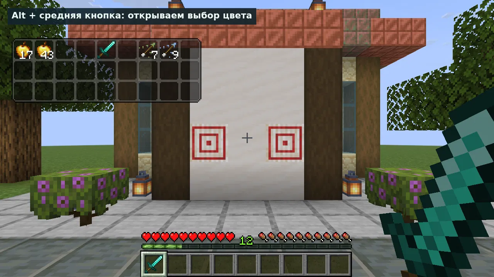
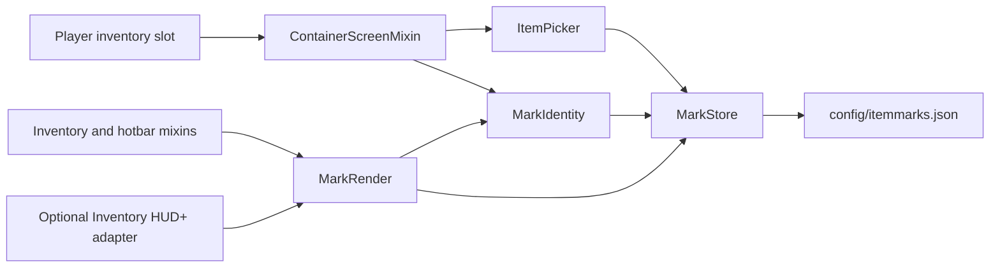

<div align="center">
<h1>Item Marks</h1>
<hr>
<b>3 parts in one place: item identity, local colors, inventory overlays.</b>
<br><br>


<br>
<a href="https://github.com/hhhhhffd/ItemMarks/releases/latest"></a>

<a href="LICENSE"></a>
<br><br>
<a href="https://github.com/hhhhhffd/ItemMarks/releases">Download</a> · <a href="#architecture">Architecture</a> · <a href="#build">Build</a>
</div>



## Overview

Item Marks is a client-side Minecraft mod that puts a translucent color behind an item in the inventory and hotbar. Marks follow item identity rather than a slot and are saved locally without modifying the item or sending inventory actions.

## Technical stack

| Area | Technology |
| --- | --- |
| Core | Minecraft Java 1.21.11, Fabric Loader 0.18.4+, Java 21+ |
| Build | Fabric Loom 1.13.6, Gradle wrapper 9.2.1, official Mojang mappings |
| Optional | Inventory HUD+ Fabric 3.4.29 adapter |
| Data | Local JSON configuration |

## Architecture



- `MarkIdentity` uses a scoped UUID when available; otherwise it hashes the item registry ID and normalized components, so a mark is not tied to a slot.
- `MarkStore` persists colors locally and prevents adding new entries once 5,000 are stored; `ItemPicker` exposes save and clear actions without changing inventory contents.
- Rendering mixins call `MarkRender` for inventory and hotbar backgrounds. A separate mixin plugin enables the Inventory HUD+ adapter only for the exact supported version.

## Project structure

```text
.
├── build.gradle          # Fabric Loom build
├── gradle/               # Gradle wrapper configuration
├── src/
│   ├── client/           # Identity, picker, rendering and adapter
│   └── main/             # Mod metadata and mixins configuration
├── tests/                # Identity math checks
└── docs/media/           # Preview image
```

## Setup and usage

1. Install Minecraft Java 1.21.11 with Fabric Loader 0.18.4 or newer and Java 21 or newer.
2. Download the JAR from [releases](https://github.com/hhhhhffd/ItemMarks/releases) and put it in the client `mods` folder. Fabric API and a server-side mod are not required.
3. Hover an item in a slot owned by your player and press **Alt + middle click**. Pick a color using the saturation/value field and hue slider, or enter a six-digit HEX code; adjust transparency with **Alpha**. **Done** saves, **Clear** removes only that identity, and **Cancel** or Esc closes without further changes.

The background follows the item between inventory and hotbar. It does not mark a slot, write to the item, change its texture, or send inventory actions.

## Identity and configuration

Marks are local in `config/itemmarks.json`. A valid UUID in server-supplied `minecraft:custom_data.uuid` or `minecraft:custom_data.ExtraAttributes.uuid` is used when available, scoped to the server or singleplayer save. Otherwise, the registry ID and normalized item components are hashed, ignoring stack quantity, damage, repair cost, and slot.

Different names, enchantments, and potions are distinct. Identical stacks without a unique ID intentionally share one mark, even when split or combined; changing identifying metadata on an item without a UUID can make it a new match.

> [!NOTE]
> The optional Inventory HUD+ **Fabric 3.4.29** adapter draws the same backgrounds behind its inventory icons. That mod is not required; other Inventory HUD+ releases use their usual rendering without this adapter.

## Build

Use Java 21:

```sh
./gradlew build
```

On Windows use `gradlew.bat build`.

## Links

- [Source](https://github.com/hhhhhffd/ItemMarks)
- [Preview](docs/media/preview.webp)
- [Releases](https://github.com/hhhhhffd/ItemMarks/releases)

## License

[MIT](LICENSE).
